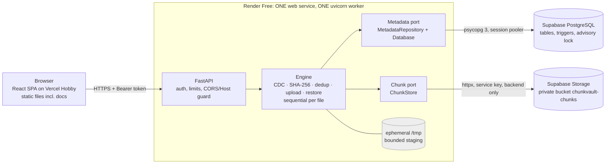

# ChunkVault cloud migration — Phase B design

**Status: design only.** No implementation file was changed. This document is the only file added for Phase B. It lives outside
`docs/` on purpose: an existing test requires every file under `docs/` to be linked from the Documentation page, and that
page is an implementation file. In Phase E it moves into `docs/` together with that link.

Items marked **⚠ verify** rest on provider behaviour that I recalled but have not tested. Phase C verifies each one before code depends on it.

Approved decisions this design follows: D1 dual backends (SQLite + local files for development, tests and rollback; Supabase
PostgreSQL + Supabase Storage in production, chosen by environment) · D2 psycopg 3 + raw SQL + Alembic, no ORM · D3 bounded concurrent
cloud I/O with correctness preserved · D4 demo token + admin token, no accounts · D5 no personal data migrated · D6 local benchmarks and
the disposable fault lab kept and labelled, plus separate cloud-path measurements.

---------------------------------------------------------------------------------------------------------------------------------

## 1. Revised high-level design

### 1.1 Components



The engine is unchanged in nature: one process, one writer at a time, files processed sequentially. Cloud services supply persistence
only. Nothing here is distributed processing and no document may claim it is.

### 1.2 Backend selection

`CHUNKVAULT_BACKEND=local` (default) keeps today's behaviour exactly. `CHUNKVAULT_BACKEND=cloud` selects PostgreSQL + Supabase
Storage and refuses to start unless all required settings are present. A single factory builds the matching pair:

| | `local` | `cloud` |
|---|---|---|
| Metadata | `SqliteDatabase` + `SqliteMetadataRepository` (existing) | `PostgresDatabase` + `PostgresMetadataRepository` (new) |
| Chunks | `FilesystemChunkStore` (existing) | `SupabaseChunkStore` (new) |
| Writer lock | thread lock + OS file lock (existing) | PostgreSQL advisory lock (new) |
| Staging | `data/staging` | OS temp dir, bounded, cleaned at start |
| Used for | development, 448 tests, rollback, benchmarks, fault lab | production |

The benchmark runner and the fault lab always construct the **local** pair on private temporary directories, whatever backend the
server uses. That is what keeps them disposable and keeps them away from user files.

### 1.3 What does not change

CDC, SHA-256 identity, the NEW/DUPLICATE/ADOPT decisions' meaning, the two-transaction ordering (bytes first, metadata last),
verified restore, metadata-first delete, API response shapes, and the labels on benchmark and simulation results.

### 1.4 API contract changes (all additive)

`401/403` on protected routes · `429` with `Retry-After` · `507 insufficient_storage` also for the demo storage quota · `/health`
(no database) next to `/api/health` · in cloud mode audit and reconcile may return `202` with a job id (see 7.5) · admin-only
`GET /api/system/cloud-metrics` · a `cloud_path` benchmark kind.

---------------------------------------------------------------------------------------------------------------------------------

## 2. Revised low-level design

### 2.1 Module map

```
backend/app/
  core/
    config.py          + backend, database_url, supabase_*, tokens, limits, concurrency (all env, validated)
    backends.py   NEW  build_backend(settings) -> Backend(db, repo, store, writer_lock); local and cloud variants
    services.py        uses Backend instead of wiring SQLite/filesystem directly
    locking.py         WriterLock stays for local; PgAdvisoryWriterLock lives in database/postgres.py
    auth.py       NEW  Role enum, token verification, FastAPI dependencies require(Role.DEMO / Role.ADMIN)
    ratelimit.py  NEW  in-memory sliding-window limiter + quota guard
    logging.py    NEW  JSON logs with request id and secret redaction
  database/
    interfaces.py NEW  Database protocol (below); repository protocol moves here
    sqlite.py          current connection.py/init.py behind SqliteDatabase (behaviour identical)
    postgres.py   NEW  pool, transaction, snapshot, advisory lock, introspection, size
    sqlite_repository.py   unchanged logic; absorbs the stray raw SQL listed in 2.3
    postgres_repository.py NEW
  storage/
    interfaces.py      ChunkStore protocol extended (below)
    filesystem.py      unchanged logic; implements the new optional methods
    supabase.py   NEW  SupabaseChunkStore + SupabaseHttp (httpx, retries, metrics)
  deduplication/       manager.py: reuse policy; upload.py: batched pipeline; deletion.py: store-agnostic
  reliability/         auditor.py, reconciler.py: snapshot + listing through the ports; jobs for cloud
  api/                 deps.py (pool), health.py, inspect.py, storage.py, files.py: no raw SQL; guard.py: hosts/origins
backend/migrations/    NEW  alembic.ini, env.py, versions/0001_initial.py (+ sql/0001_initial.sql)
```

### 2.2 The two ports

```python
class Database(Protocol):                      # one per process
    def connection(self) -> ContextManager[Conn]          # pooled (cloud) / new (local); always released
    def transaction(self, conn: Conn) -> ContextManager[Conn]
    #   local: BEGIN IMMEDIATE ... COMMIT/ROLLBACK      cloud: BEGIN (READ COMMITTED) ... COMMIT/ROLLBACK
    def snapshot(self, conn: Conn) -> ContextManager[Conn]
    #   local: BEGIN (read-only by PRAGMA query_only)   cloud: BEGIN ISOLATION LEVEL REPEATABLE READ, READ ONLY
    def writer_lock(self, timeout_s: float) -> ContextManager[None]   # raises WriterBusyError
    def ping(self) -> DbHealth                    # reachable, foreign keys on / schema version
    def introspect(self) -> SchemaInfo            # tables, columns, PK/FK  (replaces PRAGMA table_info)
    def footprint_bytes(self) -> int              # SQLite file size / pg_database_size()
    def schema_version(self) -> str

class MetadataRepository(Protocol):            # existing methods unchanged, plus the ones that absorb raw SQL
    def manifest_counts(self, conn, file_ids: list[str]) -> dict[str, int]
    def chunk_rows(self, conn, hashes: list[str]) -> dict[str, ChunkRecord]        # batch lookup (one query)
    def register_chunks(self, conn, items: list[tuple[str, int]], state) -> None   # set-based
    def append_manifest(self, conn, file_id: str, rows: list[tuple[int, str, int]]) -> None   # set-based
    def aggregate_stats(self, conn) -> StatsRow
    def table_rows(self, conn, table: Table, limit: int, offset: int) -> tuple[list[dict], int]
    def table_counts(self, conn) -> dict[str, int]
    def ref_count_mismatch_count(self, conn) -> int
    def chunk_reference_summary(self, conn, chunk_hash: str) -> RefSummary
    def total_stored_bytes(self, conn) -> int                                     # quota guard
    def save_benchmark_result(...) / list_benchmark_results(...) / get_benchmark_result(...)   # cloud persistence
```

`Conn` is opaque to callers: `sqlite3.Connection` or `psycopg.Connection`. No module outside the two repository implementations
and the two `Database` implementations may hold SQL text (a test enforces this, see section 10).

### 2.3 Raw SQL that moves behind the repository

`api/files.py` (manifest counts) · `api/health.py` · `api/inspect.py` (PRAGMA introspection, table browse) · `api/storage.py`
(chunk references) · `storage/stats.py` (aggregates) · `reliability/auditor.py` (PRAGMA query_only, snapshot) ·
`benchmarking/runner.py` (wal_checkpoint, file size; stays local-only) · the fault lab's read helper (stays local-only).

### 2.4 Chunk store port (extended, backwards compatible)

```python
@dataclass(frozen=True)
class StagedChunk: hash: str; size_bytes: int; path: Path | None = None; data: bytes | None = None   # data for cloud

class ChunkStore(Protocol):
    # existing — stage/publish/discard/exists/read/delete/iter_hashes/iter_staged keep their meaning
    def publish(self, staged) -> bool        # True = created, False = already existed (verified)
    def publish_many(self, staged: list[StagedChunk], max_workers: int) -> list[PublishResult]   # default: sequential loop
    def exists_many(self, hashes: Iterable[str], max_workers: int) -> dict[str, int | None]       # hash -> size or None
    def read(self, h: str) -> bytes
    def verify(self, h: str, expected_size: int | None = None) -> ChunkStatus    # full read + SHA-256
    def delete_many(self, hashes: list[str]) -> DeleteResult                      # per-hash outcome
    def iter_objects(self) -> Iterator[ObjectInfo]                                # hash, size, created_at
    def free_bytes(self) -> int | None       # local only; cloud returns None (the preflight is skipped)
    def stats(self) -> StoreStats            # object count/bytes (local: directory walk; cloud: DB aggregate)
```

For the cloud store, `stage` keeps the bytes in memory and `publish` performs the upload, so `Uploader` keeps its structure.

### 2.5 Concurrency model (D3)

* One upload at a time (writer lock). Inside an upload, chunking and hashing stay sequential and in file order.
* Chunks are handled in **batches** of `B` (default 64, about 1 MiB). For each batch: one DB lookup, then `exists_many` and
  `publish_many` on a `ThreadPoolExecutor(max_workers=K)`, joined before the batch ends. Memory is bounded by `B × 128 KiB` plus the
  upload spool.
* `K` and the upload limit are **configuration with conservative defaults** (K=4, limit 10 MiB) and are finalised only from
  measured latency (section 10.5). A global semaphore bounds in-flight requests to Supabase to `K` across restore and audit too.
* The database connection is used by the main thread only; worker threads touch HTTP only.
* The manifest, `chunk` registration and commit stay in the order of the file, inside one transaction.

### 2.6 Configuration (environment only; validated at start; secrets never logged)

| Variable | Meaning | Default |
|---|---|---|
| `CHUNKVAULT_BACKEND` | `local` or `cloud` | `local` |
| `DATABASE_URL` | Supabase **session pooler** URL (secret) | – |
| `SUPABASE_URL`, `SUPABASE_SERVICE_KEY`, `SUPABASE_BUCKET` | Storage REST; bucket `chunkvault-chunks` | – |
| `CHUNKVAULT_DEMO_TOKEN`, `CHUNKVAULT_ADMIN_TOKEN` | role secrets (≥ 24 random chars) | – |
| `CHUNKVAULT_CORS_ORIGINS`, `CHUNKVAULT_ALLOWED_HOSTS` | exact Vercel origin; Render hostname | local values |
| `CHUNKVAULT_MAX_UPLOAD_BYTES` | upload limit | 10 MiB in cloud |
| `CHUNKVAULT_CLOUD_IO_WORKERS`, `_BATCH_CHUNKS` | K and B | 4, 64 |
| `CHUNKVAULT_VERIFY_ON_REUSE` | `exists` \| `full` \| `none` (6.4) | `exists` |
| `CHUNKVAULT_STORED_BYTES_CAP` | demo quota | 300 MiB |
| `CHUNKVAULT_ORPHAN_MIN_AGE_S` | grace for orphan objects | 900 |
| `CHUNKVAULT_TRUSTED_PROXY_HOPS` | for the client-IP limiter | measured in Phase C |

---------------------------------------------------------------------------------------------------------------------------------

## 3. PostgreSQL schema and triggers

Entities, constraints and relationships are identical to SQLite. Identifiers stay text so a future migration of synthetic data
preserves them.

### 3.1 Type mapping

| SQLite | PostgreSQL |
|---|---|
| `TEXT` ids, hashes | `text` |
| `CHECK (length(h)=64 AND h NOT GLOB '*[^0-9a-f]*')` | `CHECK (h ~ '^[0-9a-f]{64}$')` |
| `INTEGER` sizes | `bigint` (file size) / `integer` (chunk size) |
| ISO text timestamps, `strftime(...)` default | `timestamptz DEFAULT now()`; the repository formats to the same `YYYY-MM-DDTHH:MM:SS.mmmZ` string so API output is unchanged |
| `INTEGER PRIMARY KEY AUTOINCREMENT` | `bigint GENERATED ALWAYS AS IDENTITY` |
| `PRAGMA foreign_keys`, `user_version` | always-on FKs; `alembic_version` |
| `BEGIN IMMEDIATE` + file lock | transaction + advisory lock (7.1) |

### 3.2 Migration `0001_initial` (SQL executed by Alembic; no schema qualifiers, so tests can run it in a throw-away schema)

```sql
CREATE TABLE files (
  file_id text PRIMARY KEY CHECK (length(file_id) > 0),
  filename text NOT NULL CHECK (char_length(filename) BETWEEN 1 AND 255),
  original_size bigint NOT NULL CHECK (original_size >= 0),
  sha256 text CHECK (sha256 IS NULL OR sha256 ~ '^[0-9a-f]{64}$'),
  status text NOT NULL DEFAULT 'uploading' CHECK (status IN ('uploading','complete','failed','deleting')),
  created_at timestamptz NOT NULL DEFAULT now(),
  CHECK (status <> 'complete' OR sha256 IS NOT NULL));
CREATE TABLE chunks (
  hash text PRIMARY KEY CHECK (hash ~ '^[0-9a-f]{64}$'),
  size_bytes integer NOT NULL CHECK (size_bytes > 0),
  ref_count integer NOT NULL DEFAULT 0 CHECK (ref_count >= 0),
  state text NOT NULL DEFAULT 'pending' CHECK (state IN ('pending','stored','corrupt')),
  created_at timestamptz NOT NULL DEFAULT now());
CREATE TABLE file_chunks (
  file_id text NOT NULL REFERENCES files(file_id) ON DELETE CASCADE,
  chunk_index integer NOT NULL CHECK (chunk_index >= 0),
  chunk_hash text NOT NULL REFERENCES chunks(hash) ON DELETE RESTRICT,
  chunk_size integer NOT NULL CHECK (chunk_size > 0),
  PRIMARY KEY (file_id, chunk_index));
CREATE TABLE operations (
  operation_id bigint GENERATED ALWAYS AS IDENTITY PRIMARY KEY,
  file_id text REFERENCES files(file_id) ON DELETE SET NULL,
  operation_type text NOT NULL CHECK (operation_type IN
      ('upload','restore','delete','integrity_check','reconciliation','benchmark','simulation')),
  status text NOT NULL DEFAULT 'running' CHECK (status IN ('running','succeeded','failed','aborted')),
  started_at timestamptz NOT NULL DEFAULT now(),
  completed_at timestamptz,
  error_message text,
  CHECK ((status = 'running') = (completed_at IS NULL)),
  CHECK (status <> 'failed' OR error_message IS NOT NULL));
CREATE TABLE benchmark_results (          -- Postgres only: Render's disk is ephemeral
  job_id text PRIMARY KEY, kind text NOT NULL, finished_at timestamptz NOT NULL DEFAULT now(),
  spec jsonb NOT NULL, result jsonb NOT NULL);
CREATE INDEX idx_files_sha256 ON files(sha256);       CREATE INDEX idx_files_status ON files(status);
CREATE INDEX idx_chunks_state ON chunks(state);       CREATE INDEX idx_chunks_ref_count ON chunks(ref_count);
CREATE INDEX idx_file_chunks_hash ON file_chunks(chunk_hash);
CREATE INDEX idx_operations_file_id ON operations(file_id);
CREATE INDEX idx_operations_status ON operations(status, operation_type);
```

### 3.3 Triggers (same five rules, same messages)

```sql
CREATE FUNCTION cv_fc_check_size() RETURNS trigger LANGUAGE plpgsql AS $$
BEGIN
  IF NEW.chunk_size <> (SELECT size_bytes FROM chunks WHERE hash = NEW.chunk_hash) THEN
    RAISE EXCEPTION 'file_chunks.chunk_size must equal chunks.size_bytes' USING ERRCODE = '23514';
  END IF; RETURN NEW; END $$;
CREATE TRIGGER trg_file_chunks_check_size BEFORE INSERT ON file_chunks FOR EACH ROW EXECUTE FUNCTION cv_fc_check_size();

CREATE FUNCTION cv_fc_ref_inc() RETURNS trigger LANGUAGE plpgsql AS $$
BEGIN UPDATE chunks SET ref_count = ref_count + 1 WHERE hash = NEW.chunk_hash; RETURN NULL; END $$;
CREATE TRIGGER trg_file_chunks_ref_inc AFTER INSERT ON file_chunks FOR EACH ROW EXECUTE FUNCTION cv_fc_ref_inc();

CREATE FUNCTION cv_fc_ref_dec() RETURNS trigger LANGUAGE plpgsql AS $$
BEGIN UPDATE chunks SET ref_count = ref_count - 1 WHERE hash = OLD.chunk_hash; RETURN NULL; END $$;
CREATE TRIGGER trg_file_chunks_ref_dec AFTER DELETE ON file_chunks FOR EACH ROW EXECUTE FUNCTION cv_fc_ref_dec();

CREATE FUNCTION cv_fc_immutable() RETURNS trigger LANGUAGE plpgsql AS $$
BEGIN RAISE EXCEPTION 'file_chunks rows are immutable; delete and re-insert instead' USING ERRCODE = '23000'; END $$;
CREATE TRIGGER trg_file_chunks_immutable BEFORE UPDATE ON file_chunks FOR EACH ROW EXECUTE FUNCTION cv_fc_immutable();

CREATE FUNCTION cv_chunks_identity() RETURNS trigger LANGUAGE plpgsql AS $$
BEGIN RAISE EXCEPTION 'chunks.hash and chunks.size_bytes are immutable' USING ERRCODE = '23000'; END $$;
CREATE TRIGGER trg_chunks_identity_immutable BEFORE UPDATE OF hash, size_bytes ON chunks FOR EACH ROW EXECUTE FUNCTION cv_chunks_identity();

CREATE VIEW v_ref_count_mismatch AS
SELECT c.hash, c.ref_count AS recorded_ref_count, COUNT(fc.chunk_hash) AS actual_ref_count
FROM chunks c LEFT JOIN file_chunks fc ON fc.chunk_hash = c.hash
GROUP BY c.hash HAVING c.ref_count <> COUNT(fc.chunk_hash);
```

Why the invariant survives: row-level `AFTER` triggers fire once per inserted or deleted manifest row, including repeats of one hash
and rows removed by `ON DELETE CASCADE` (cascade actions run as ordinary deletes, so the triggers fire). `ON DELETE RESTRICT` and the
`ref_count >= 0` check stop a chunk row being removed or going negative. `BEFORE UPDATE OF hash,size_bytes` fires on any update that
names those columns, as in SQLite. Set-based inserts (`INSERT … SELECT FROM unnest(...)`) still fire the row triggers, but server-side,
so one round trip adds a whole manifest. A statement-level variant is a measured-only optimisation, not planned.

### 3.4 Exposure and roles (important on Supabase)

Supabase publishes tables through its REST API to the public `anon` key unless protected. The migration therefore also runs
`ALTER TABLE … ENABLE ROW LEVEL SECURITY` on every table (no policies) and `REVOKE ALL … FROM anon, authenticated` on tables and
functions. The backend connects through the pooler with its own role, so RLS does not affect it. Recommended hardening (optional): a
dedicated `chunkvault_app` role with only `SELECT/INSERT/UPDATE/DELETE` on these tables and `EXECUTE` on nothing else, created by a
documented one-time step because a password cannot live in a migration file; migrations run as the owner.

### 3.5 Migration tooling

Alembic with raw SQL (`op.execute(Path("sql/0001_initial.sql").read_text())`); SQLAlchemy is installed only as Alembic's engine. The
runtime never imports it. Migrations are run **manually** (`alembic upgrade head` from a developer machine with `DATABASE_URL`);
Render Free has no pre-deploy hook ⚠ verify. At startup the service only checks that the schema version equals head and reports
`503 schema_out_of_date` otherwise. An opt-in `CHUNKVAULT_AUTO_MIGRATE=1` could run migrations under the advisory lock; default off.
Tests run the same SQL in a throw-away schema (`SET search_path`).

### 3.6 Error mapping

`23514` → `ChunkSizeConflict`/`RepositoryError`; `23503` → foreign-key `RepositoryError`; `23505` → duplicate; `23000` → immutability
`RepositoryError`; connection and timeout classes → `DatabaseError` (HTTP 503 with a safe message). Messages stay free of SQL, DSNs and paths.

### 3.7 Connections

psycopg 3 `ConnectionPool(min=1, max=4)`; `prepare_threshold=None` (safe with any pooler mode); `connect_timeout=10`,
`options='-c statement_timeout=30000 -c lock_timeout=5000 -c idle_in_transaction_session_timeout=60000'`; TCP keepalives on
(idle 30 s, interval 10 s, count 3). The writer lock uses one **dedicated** connection outside the pool, so the pool never
exceeds 5 connections in total. Use the **session** pooler, not the transaction pooler ⚠ verify the host/user format and that
the direct host is IPv6-only.

---------------------------------------------------------------------------------------------------------------------------------

## 4. Supabase Storage adapter

### 4.1 Layout and semantics

Private bucket `chunkvault-chunks`; object key `{h[0:2]}/{h}` (flat names, two-hex prefix so listing can be paged per prefix). Objects are
immutable: created only with no-overwrite semantics, never updated. Only the backend holds the service key.

### 4.2 Low-level client and its REST mapping ⚠ verify each against the live API in Phase C

| Operation | REST call | Notes |
|---|---|---|
| `put_if_absent(key, data)` | `POST /storage/v1/object/{bucket}/{key}` with header `x-upsert: false` | success = created. "already exists" is returned as a duplicate error (I recall HTTP 400 with `statusCode:"409"`); the adapter accepts both 409 and that form → `EXISTS` |
| `head(key)` | `HEAD /storage/v1/object/authenticated/{bucket}/{key}` (or `/object/info`) | size from `Content-Length`; 404 → absent |
| `get(key)` | `GET /storage/v1/object/authenticated/{bucket}/{key}` | whole object (≤128 KiB) |
| `delete_many(keys)` | `DELETE /storage/v1/object/{bucket}` body `{prefixes:[...]}` | ≤100 keys per call; per-key result checked |
| `list(prefix, limit, offset)` | `POST /storage/v1/object/list/{bucket}` | paged; returns name, size (`metadata.size`), `created_at` |

Client settings: one `httpx.Client` (HTTP/1.1 keep-alive pool, `max_connections = K`), timeouts connect 5 s / read 15 s / total
per call 20 s. TLS verification stays on. The service key is only ever in the `Authorization`/`apikey` headers, never in URLs or logs.

### 4.3 Retry policy (bounded)

Retry only idempotent calls on: connect/read timeout, connection reset, HTTP 408/429/500/502/503/504. At most 3 attempts; delays
0.4 s, 1.0 s plus ±25 % jitter; honour `Retry-After` up to 5 s; a total deadline per logical operation. Never retry 400/401/403/404/413.
`put_if_absent` is idempotent because a replay after a lost response returns `EXISTS`, which is accepted after a size check (6.3).
Exhausted retries raise `ChunkWriteError`/`ChunkNotFoundError`-class errors with `reason=network|timeout|server` (HTTP 503/502 to the
client, never a stack trace).

### 4.4 Integrity checks at the adapter

`publish` → on `EXISTS`, `head` must report the expected size, otherwise `ChunkCorruptedError`. `read` → length must equal the recorded
size. `verify` → `read` + SHA-256 compare. The restore path and the auditor always call `verify`/`read` + hash, independent of
`VERIFY_ON_REUSE`.

### 4.5 Metrics (D6)

Each call records latency, status and bytes into a bounded in-process histogram (per operation: put, head, get, delete, list, plus DB
ping). `GET /api/system/cloud-metrics` (admin) exposes percentiles; the cloud-path benchmark and `scripts/measure_cloud_latency.py` use the
same client. These are measurements only; no claim of improvement is made without them.

---------------------------------------------------------------------------------------------------------------------------------

## 5. Sequence diagrams

### 5.1 Upload (cloud)

```mermaid
sequenceDiagram
  actor U as Browser
  participant A as FastAPI (auth, limits)
  participant E as Uploader
  participant L as Writer lock (pg advisory)
  participant D as PostgreSQL
  participant S as Supabase Storage
  U->>A: POST /api/files (Bearer demo token, multipart)
  A->>A: verify role, rate limit, size limit, quota
  A->>E: upload(filename, stream)
  E->>L: acquire (timeout 30 s, else 409 writer_busy)
  E->>E: spool to /tmp, whole-file SHA-256, enforce limit
  E->>D: T1 insert file(uploading) + operation(running)  COMMIT
  loop each batch of B chunks, in file order
    E->>E: CDC cut + SHA-256 (sequential)
    E->>D: SELECT chunk rows WHERE hash = ANY(batch)
    par up to K concurrent
      E->>S: HEAD key  (rows stored: existence + size)
    and
      E->>S: PUT key, x-upsert false  (no row: create; EXISTS = adopt after size check)
    end
    E->>E: join batch; any failure aborts the upload
  end
  E->>D: T2 register new chunk rows, append manifest, file(complete, sha256), operation(succeeded)  COMMIT
  E->>L: release
  A-->>U: 201 UploadResponse
  Note over E,S: on any failure before T2: file(failed), operation(failed), spool removed,<br/>objects this upload surely created are deleted best-effort; the rest are left for reconcile
```

### 5.2 Restore / download (cloud)

```mermaid
sequenceDiagram
  actor U as Browser
  participant A as FastAPI
  participant R as Restorer
  participant D as PostgreSQL
  participant S as Supabase Storage
  U->>A: GET /api/files/{id}/download (Bearer demo token)
  A->>R: restore_to_file(id, /tmp/restore-x)
  R->>D: file (must be complete) + ordered manifest; operation(running)
  loop chunks in manifest order (prefetch window of K)
    R->>S: GET key
    R->>R: length = recorded size AND SHA-256 = name, else explicit error
    R->>R: append to temp file, update whole-file hash
  end
  R->>R: size and whole-file SHA-256 must match the recorded values
  R->>D: operation(succeeded or failed)
  A-->>U: stream the verified temp file, then delete it
  Note over R: failure at any step: temp file removed, operation failed, nothing partial is sent
```

### 5.3 Delete (cloud)

```mermaid
sequenceDiagram
  actor U as Admin
  participant A as FastAPI (admin role)
  participant X as Deleter
  participant L as Writer lock
  participant D as PostgreSQL
  participant S as Supabase Storage
  U->>A: DELETE /api/files/{id} (Bearer admin token)
  A->>X: delete(id)
  X->>L: acquire
  X->>D: one transaction: delete file row (manifest cascades, triggers lower counts), delete chunk rows that reached 0   COMMIT
  X->>S: delete_many(hashes whose rows were removed)   (after commit)
  X->>L: release
  A-->>U: 200 {released, reclaimed, bytes}
  Note over X,S: if the object delete fails the object is merely an orphan; reconcile removes it later.<br/>Objects of chunks still referenced are never in the delete list.
```

---------------------------------------------------------------------------------------------------------------------------------

## 6. Transaction and consistency protocol

### 6.1 Rule

PostgreSQL and Storage cannot commit together. The same ordering as the local engine applies: **object bytes first, metadata last,
one metadata transaction makes the file visible**. Deletes go the other way: **metadata first, bytes last**. Every step is idempotent
or safely repeatable.

### 6.2 Invariants

* **C1** A `complete` file's manifest references only chunks whose objects existed at commit time.
* **C2** `ref_count` equals the number of committed manifest rows (trigger-maintained, audited by the view).
* **C3** No object referenced by any committed manifest row is ever deleted.
* **C4** A `complete` file's whole-file SHA-256 matches its restored bytes (checked on every restore).
* **C5** After any crash only harmless leftovers exist: `uploading` files, `running` operations, unreferenced objects.
* **I1–I8** from the existing fault lab keep their meaning on both backends.

Why C1 and C3 hold without a distributed transaction: uploads, deletes and reconciliation are serialised by one database-level
advisory lock that is held for the whole operation. Therefore no delete or cleanup can run between "this upload verified object X
exists" and "this upload's T2 commits". Objects are immutable and bucket write access exists only in the backend.

### 6.3 Crash and failure analysis (upload)

| Where it stops | Database | Storage | Result / recovery |
|---|---|---|---|
| before T1 | nothing | nothing | nothing to do |
| after T1, before any PUT | file `uploading`, op `running` | nothing | stale rows; marked failed by reconcile |
| mid-batch | same | some objects, no rows | orphans; GC removes them (7.3) |
| all PUTs done, before T2 | same | all objects, no rows | orphans; a retry upload adopts them (PUT returns EXISTS) |
| inside T2 | rolled back as a unit | all objects | as above; never a half-visible file |
| after T2, response lost | file `complete` | all objects | file exists; a client retry creates a second logical file that reuses every chunk |
| Render restart/spin-down mid-upload | session ends, lock released | partial | as "mid-batch" |
| Supabase unreachable mid-upload | file marked failed (if the DB is reachable) | partial | cleanup deletes only objects this upload **certainly** created; after a retried PUT whose first reply was lost, "created by us" is ambiguous, so it is left for GC |
| database unreachable at T2 | transaction not committed | all objects | upload fails with 503; orphans only |

### 6.4 Existence-based deduplication: the integrity assumption (D3)

`CHUNKVAULT_VERIFY_ON_REUSE`:

* `full` — GET + SHA-256 of every reused chunk (today's local behaviour; correct, but one full read per duplicate chunk).
* `exists` (cloud default) — a chunk row in state `stored` plus an object whose existence and **size** are confirmed by `HEAD`.
* `none` — rely on the row alone (cheapest; not recommended).

What `exists` assumes: (1) objects are immutable and only the backend can write them; (2) Storage returns the bytes it stored;
(3) the recorded size is a cheap tripwire against truncation or the wrong object. What it does **not** catch: silent corruption of an
object's content. Consequence: a new upload may reference such a chunk, but that can never produce wrong output: every restore verifies
each chunk's SHA-256 and the whole file, and every audit re-hashes all objects, so damage is reported explicitly (C4) and never
returned as a successful file. The assumption is documented in the consistency protocol and security review, and the setting can be
raised to `full` for small demonstrations.

### 6.5 Isolation and timeouts

READ COMMITTED for T1/T2 (single writer, row-level triggers lock the touched chunk rows); `REPEATABLE READ, READ ONLY` for the
auditor's snapshot. Statement, lock and idle-in-transaction timeouts as in 3.7 keep a broken connection from holding resources.

---------------------------------------------------------------------------------------------------------------------------------

## 7. Recovery, garbage collection and locking

### 7.1 Advisory lock design (D4-adjacent requirement 4)

* One constant bigint key. Acquire with `pg_try_advisory_lock(key)` in a retry loop (sleep 100 ms, up to the timeout) on a dedicated
  connection; timeout → `409 writer_busy`. Session-level lock, so it spans T1, the cloud I/O and T2.
* **Release:** explicit `pg_advisory_unlock` in `finally`. If the process dies (crash, SIGKILL, Render restart or spin-down) the
  connection closes and PostgreSQL releases the lock. Keepalives (3.7) make a silently vanished client detectable; the pooler
  closes the matching server session when the client goes away ⚠ verify in Phase C by killing a client mid-lock.
* **Across Render deployments:** during a deploy two instances can overlap briefly. Both use the same lock, so they cannot write at once;
  the loser waits or gets `409`. Old instances get SIGTERM; the app stops accepting uploads, lets the current one finish up to the
  platform grace period, and exits. An upload cut short ends as a stale `uploading` file (6.3).
* **Zombie lock** (server session surviving a dead client): `lock_timeout` is not enough because the holder is not waiting. Mitigation
  is keepalives plus `idle_in_transaction_session_timeout`; the runbook gives the admin query that finds the holder
  (`pg_locks` join `pg_stat_activity`) and `pg_terminate_backend`. This is a listed unresolved risk.
* **Stale detection without clocks:** anyone who holds the lock knows no upload is in flight, so every `uploading` file and `running`
  operation is stale by definition. That replaces today's age heuristics in cloud mode (the age rule remains for the local backend).

### 7.2 Startup

Never destructive. The service verifies configuration and schema version, creates the bounded temp directory and deletes its leftovers,
and opens the pool. It does not delete objects or rows.

### 7.3 Garbage collection of orphaned objects (reconcile, cloud)

Candidates: (a) objects with no `chunks` row; (b) `chunks` rows with `ref_count = 0` (unreferenced). Also reported but never "repaired":
rows whose object is missing, objects whose hash/size do not match, rows in state `corrupt`.

1. Acquire the writer lock (this guarantees no upload is in flight).
2. List the bucket page by page (per two-hex prefix) into a candidate set; load the chunk table keys; compute the differences.
3. For each candidate re-check in the database immediately before acting: no `file_chunks` row references it **and** (for objects) no
   `chunks` row exists. This protects against tampered counters, as the local reconciler does today.
4. Objects must be older than `ORPHAN_MIN_AGE_S` (default 15 min) as a second defence against a writer without the lock.
5. Delete rows first (transaction), then objects in batches of ≤100; record per-key outcomes. A failed delete leaves a harmless orphan.
6. Mark stale `uploading` files `failed` and stale `running` operations `aborted` with an explanation.
7. Write one `reconciliation` operation with counts. A **dry-run/preview** uses the same code with step 5 disabled and is what the UI
   shows before asking for confirmation.
8. Idempotent and resumable: re-running only finds what remains. Never touches objects outside the bucket prefix.

### 7.4 Audit (cloud, read-only)

`REPEATABLE READ READ ONLY` snapshot of the metadata; list objects; for each referenced chunk `read` + SHA-256 (bounded concurrency
K); check manifests, sizes, counts and the view. Findings use the existing kinds plus `missing_chunk_object`. It changes nothing.

### 7.5 Long operations and the request timeout

Audit and reconcile read or list many objects. In cloud mode they run as **in-process background jobs** (a thread, one at a time,
like the benchmark runner's job model) and return `202 {job_id}`; the UI polls `GET /api/jobs/{id}` (progress, partial counts, result).
A restart marks a running job failed. In local mode the endpoints stay synchronous exactly as today. Uploads and restores stay
synchronous; the upload limit is chosen so that the measured p95 time stays well under the proxy limit ⚠ I recall about 100 s in front
of Render, to be confirmed.

---------------------------------------------------------------------------------------------------------------------------------

## 8. Authentication and security

### 8.1 Roles and route matrix (server-enforced; frontend checks are conveniences only)

| Role | How | Routes |
|---|---|---|
| public | none | static site and all documentation; `/health`; `GET /api/health`; `/api/planned-endpoints`; `/api/system/config`; `/api/system/chunking-demo` (bounded, generated data, tight rate limit); `POST /api/simulations` (pure computation); `/api/docs` is off in cloud |
| demo | `Authorization: Bearer <demo token>` | list/detail/download of files, `POST /api/files`, chunks, `GET /api/storage/stats`, `/api/inspect/*`, reading jobs, listing saved benchmark results |
| admin | `Authorization: Bearer <admin token>` (implies demo) | `DELETE /api/files/{id}`, `POST /api/integrity/audit`, `/reconcile`, `POST /api/benchmarks` and cancel, `POST /api/reliability/experiments`, cloud metrics |

The fault lab additionally needs `CHUNKVAULT_ENABLE_FAULT_LAB=1` and still only touches its own temporary stores.

### 8.2 Token handling

Two independent random secrets in Render environment variables. Verified server-side with `hmac.compare_digest` on every protected request;
no sessions, cookies or JWT. The frontend never contains either token: the interface asks the visitor to type the **demo access code**
(and, for the owner, the **admin token**) into an Access panel; they are held **in memory only**, sent only to the configured API origin, and lost on
reload. They are not stored by the app and not logged. Rotation = change the variable and restart. Missing/invalid token → `401` with `WWW-Authenticate: Bearer`; valid
demo token on an admin route → `403`; messages never reveal which secret failed.

### 8.3 Throttling, limits and quota

In-memory sliding windows keyed by client IP (bounded table): auth failures 10/min then `429`; general 120/min; uploads 6/min; public
chunking-demo 10/min; benchmarks 2/hour. Body limit stays (limit + 1 MiB overhead). One upload at a time via the lock; waiting
requests time out with `409`. A **storage quota** (`STORED_BYTES_CAP`, default 300 MiB of the free 1 GiB, and a row-count cap) refuses
uploads with `507` before any object is written. Client IP comes from `X-Forwarded-For` honouring `TRUSTED_PROXY_HOPS` (measured in Phase C).
Limits reset on restart or spin-down; that is accepted for a single-instance demo and stated in the security review.

### 8.4 Other protections

* **CORS:** exactly one origin (the production Vercel URL; previews only if listed), methods GET/POST/DELETE, headers `Content-Type, Authorization`.
  CORS is not an access control and is not treated as one.
* **Host/Origin guard:** keeps working; `ALLOWED_HOSTS` contains the Render hostname; modification requests need an allowed `Origin` or none.
* **Supabase:** bucket private; no storage policies for `anon`; RLS on every table; service key only in Render; no PostgREST use.
* **Validation:** filename sanitisation (existing), size limit, content treated as opaque bytes, downloads as `application/octet-stream` attachment.
* **Errors:** same envelope; internal causes mapped to safe codes; paths, DSNs, SQL, keys and tokens scrubbed.
* **Logs:** JSON lines with request id, method, path (no query string), status, duration, role; a redaction filter drops any configured secret
  value and the `Authorization` header; never log bodies.
* **Frontend headers (Vercel):** `X-Content-Type-Options`, `Referrer-Policy`, `frame-ancestors 'none'`, and a Content-Security-Policy whose `connect-src`
  is the API origin (first in report-only mode because Mermaid may need relaxed `script-src`/`style-src` ⚠ verify).
* **Public architecture documentation** is part of the static bundle, so it needs no API and no token.

---------------------------------------------------------------------------------------------------------------------------------

## 9. Deployment architecture (free tier)

```
 Vercel Hobby (static)  ──HTTPS──►  Render Free web service  ──►  Supabase Free
 React build + bundled docs         FastAPI, 1 uvicorn worker      PostgreSQL (session pooler)
 VITE_API_BASE_URL = Render URL     /tmp spool, no persistent       Storage: private bucket
 (public value, not a secret)       disk, secrets in dashboard
```

* **Render** (`render.yaml`, root dir `backend`): Python runtime pinned to 3.12 (`PYTHON_VERSION`; local 3.12 is available, so the
  suite is run on it in Phase C — the project is only tested on 3.14.6 today); build `pip install -r requirements.txt` with pinned
  versions; start `uvicorn app.main:app --host 0.0.0.0 --port $PORT --workers 1`; health check path `/health`; every secret `sync: false`.
  Free plan only. No disk is attached.
* **Cold starts and timeouts:** Render Free spins down when idle and wakes in roughly a minute ⚠ verify. The frontend therefore calls `/health` on load,
  shows a "server waking up" banner, retries reads with backoff for up to about 90 s, uses long timeouts for upload/download, and never auto-retries
  non-idempotent writes. Upload size and concurrency are set from measurements so a request stays under the proxy limit.
* **Supabase:** free projects pause after about a week without activity ⚠ verify. An optional GitHub Actions workflow can ping `/api/health` every few days
  (documented, not enabled by default). Quotas to respect: ~500 MB database, ~1 GB storage, per-object limit far above 128 KiB, monthly egress
  (restores and audits consume it; the audit reports bytes read).
* **Vercel:** `vercel.json` at the repository root: build `cd frontend && npm ci && npm run build`, output `frontend/dist`, single-page-app rewrite to
  `index.html` for non-asset paths, security headers. Building from the root is deliberate: the Documentation, ADR and schema pages read files outside
  `frontend/` at build time (`docs/**`, `backend/app/database/schema.sql`, and the PostgreSQL migration SQL once added). A Vitest test asserts that the
  glob finds the expected documents, so a build that silently omits them fails.
* **Schema assets in the UI:** the reference-count walkthrough reads both SQL sources and shows the SQLite (development) and PostgreSQL (production)
  trigger definitions, labelled.
* **Rollback:** set `CHUNKVAULT_BACKEND=local` (the service then uses ephemeral local data and the cloud data is untouched), or redeploy the
  previous Render commit; migrations are additive and have a `downgrade`.

---------------------------------------------------------------------------------------------------------------------------------

## 10. Implementation plan and test strategy

### 10.1 File-by-file plan

**New:** `core/backends.py`, `core/auth.py`, `core/ratelimit.py`, `core/logging.py`; `database/interfaces.py`, `sqlite.py`, `postgres.py`,
`postgres_repository.py`; `storage/supabase.py`; `api/jobs.py`; `backend/migrations/*`; `scripts/migrate_sqlite_to_postgres.py` (synthetic data only,
repeatable, refuses the real database unless forced); `scripts/upload_local_chunks_to_supabase.py` (hash-verifies, never deletes locally);
`scripts/measure_cloud_latency.py`; `scripts/verify_cloud.py`; `render.yaml`; `vercel.json`; `docs/deployment/*` and ADR-0009 (cloud persistence).

**Changed (behaviour-preserving for `local`):** `core/config.py`, `core/services.py`, `main.py`, `api/{deps,health,inspect,storage,files,guard,integrity,
reliability,benchmarks,system}.py`, `database/{connection,init,repository,sqlite_repository}.py` (moved/extended), `storage/{interfaces,filesystem,stats}.py`,
`deduplication/{manager,upload,deletion}.py`, `restoration/engine.py`, `reliability/{auditor,reconciler}.py`, `benchmarking/{runner,jobs,worker}.py`
(persist results; label scope), `requirements.txt` (pinned; adds psycopg[binary], psycopg_pool, alembic, sqlalchemy, httpx moved to runtime),
`.env.example`, `.gitignore`, README, `frontend/src/services/api.js` (token header, `/health` wake-up, timeouts, job polling),
`layouts/AppLayout.jsx` (cold-start banner), new Access panel, `pages/ReliabilityPage.jsx` (job polling in cloud mode), `pages/RefCountWalkthrough.jsx`
(two SQL sources), `pages/PerformancePage.jsx` (cloud-path section), docs and verification documents.

**Untouched:** `chunking/rabin.py`, `hashing/*`, `simulation/model.py`, the schemas for existing responses (additive fields only).

### 10.2 The 448 existing tests

They keep running unchanged against `local`, which is the default. Classification so nothing is silently skipped:

| Group | Count of files | Plan |
|---|---|---|
| Backend-neutral behaviour (API, security, config, docs, simulation, system) | ~9 files | unchanged; later also parametrised over `cloud` with fakes where cheap |
| SQLite/filesystem internals (`test_database_schema`, parts of `test_storage_engine`, `test_hardening` tampering, `test_hashing_and_store`, `test_upload_free_space`, `test_faultlab`) | 6 files | stay as the **local variants**; the intent of each gets a PostgreSQL/cloud twin (below) |
| Docs consistency | 1 file | extended (new routes, migration SQL, no SQL outside repositories) |

### 10.3 New tests

* **Repository contract suite** parametrised over `sqlite` and `postgres`: every method, error mapping, set-based insert, snapshot semantics.
* **PostgreSQL schema tests:** the equivalents of `test_database_schema` (constraints, FK restrict/cascade/set null, all five triggers, repeated hash counts,
  cascade lowers counts, view empty, immutability) plus RLS present and `anon` has no privileges.
* **Chunk store contract suite** over `filesystem`, an in-memory cloud fake with Supabase-like semantics (including the duplicate error form), and
  `SupabaseChunkStore` against `httpx.MockTransport` (timeouts, 429/5xx with retry, non-retryable 4xx, lost-response replay, size mismatch, list paging, delete batching).
* **Cloud upload protocol tests** using the existing checkpoint seam: crash at each point in 6.3 with a fake store and PostgreSQL; assert C1–C5, no
  committed file with missing chunks, ref counts equal manifest occurrences, retry succeeds, reconcile cleans. Concurrency bound test (never more than K in flight).
* **Advisory lock tests:** two connections contend; timeout → 409; lock released on connection close; deploy-overlap simulation.
* **GC tests:** orphan with and without row, tampered counters, grace window, partial delete failure, dry-run equals real run.
* **Auth/limits tests:** role matrix for every route, constant-time compare used, 401/403 shapes, throttling, quota 507, headers, log redaction.
* **Frontend:** token never in the bundle (test greps `dist`), Access panel, cold-start banner, job polling, docs/schema glob count, SPA fallback config.
* **Standing rule:** a static test fails if SQL text appears outside the repository/database modules.

### 10.4 Where PostgreSQL comes from in tests

Tests marked `postgres` read `TEST_DATABASE_URL` and skip when it is absent, so the default 448 never depend on a database. Preferred source: a
local throw-away PostgreSQL (no Docker), or a dedicated disposable Supabase project; each test run creates and drops its own schema. Whether an embedded
PostgreSQL package supports this machine's Python is checked at the start of Phase C. Cloud integration runs use a unique bucket key prefix and DB schema
and clean up after themselves; synthetic data only (D5).

### 10.5 Measuring before choosing limits (D3, D6)

Before fixing `K`, `B` and the upload limit, `scripts/measure_cloud_latency.py` records p50/p95/max for PUT, HEAD, GET, DELETE, list and a DB round trip
from the developer machine and, via an admin-only bounded `cloud_path` benchmark, from the Render instance. That benchmark also runs one real
synthetic upload + restore through the engine (then deletes it) and labels every figure "measured from <host> to <region>". Local-engine benchmarks keep
running on temporary SQLite stores and are labelled "local engine on this host"; no number from one is presented as the other.

### 10.6 Order of work in Phase C

1. Interfaces and `Backend` factory with `local` behaviour identical (448 stay green). 2. Postgres schema, migration, repository + contract tests.
3. Supabase store + HTTP client + fakes + contract tests; verify the ⚠ items against a real test project. 4. Batched upload pipeline, restore, delete,
advisory lock, recovery and GC, with the crash-point tests. 5. Auth, limits, quota, logging. 6. Measurements, then final `K`/limit. 7. Docs for each.

---------------------------------------------------------------------------------------------------------------------------------

## 11. Trade-offs and unresolved risks

### 11.1 Trade-offs made

* **Dual backends** cost two implementations and a contract-test layer, but keep the 448 tests, local development, rollback and the disposable fault lab.
* **Existence-based reuse** trades a full re-hash per duplicate for one `HEAD`; the integrity guarantee moves to restore and audit (6.4) and is documented.
* **Threads, not async I/O:** the engine and psycopg code are synchronous and FastAPI already runs them in a thread pool; a small pool keeps correctness reviewable.
* **Advisory lock instead of a lease table:** simpler and tied to the connection's life, at the price of depending on the pooler releasing dead sessions.
* **Jobs for audit/reconcile in cloud mode** add an endpoint shape and UI polling in exchange for staying clear of proxy timeouts.
* **Manual migrations:** one extra deploy step, no privileged DDL running inside the web process.
* **In-memory rate limiting:** no extra service, but limits reset on restart.
* **One object per chunk** keeps content addressing and idempotent publication simple; it multiplies requests (about 620 per 10 MiB). Packing chunks would
  cut requests but change the storage protocol, so it is not planned.

### 11.2 Unresolved risks

1. **CPU on Render Free.** The pure-Python chunker ran at 2–3 MiB/s on this laptop; the free instance has far less CPU (I recall 0.1 vCPU ⚠). Chunking alone could
   dominate a 10 MiB upload. Measured in Phase C; the limit may need to fall to a few MiB.
2. **Proxy request timeout** (≈100 s ⚠) versus upload/restore time; jobs cover audit/reconcile but not uploads.
3. **Supabase behaviours to confirm:** duplicate-upload response, list paging/size field, batch delete, HEAD support, pooler session semantics, lock release for vanished clients.
4. **Zombie advisory lock** if a dead client's server session lingers.
5. **Free-tier policies and quotas** can change or pause projects; egress is consumed by restores and audits.
6. **Python 3.12 on Render** versus the 3.14.6 development version: needs the suite run on 3.12.
7. **PostgreSQL for tests** on Windows/Python 3.14 (embedded options) is unverified.
8. **Client-IP detection** behind Render's proxy chain for the rate limiter.
9. **Service-role key breadth:** it can read and write everything in the project; mitigated by backend-only use, RLS, a private bucket and optionally the
   limited database role, but it remains a high-value secret.
10. **Demo tokens are shared secrets,** not user identities; there is no per-user audit trail or revocation short of rotating the secret.
11. **CSP vs Mermaid** may force relaxed directives.
12. **Single instance, no high availability:** an outage of any of the three providers is an outage of the demo, and none of this is a distributed-processing claim.

### 11.3 Remaining choices (defaults shown; say if you want different)

E1 migrations run manually (default) vs auto at startup · E2 audit/reconcile as background jobs in cloud mode (default) vs time-budgeted partial results ·
E3 dedicated least-privilege database role (recommended, optional) vs the pooler's default role · E4 demo quota 300 MiB of the 1 GiB free storage ·
E5 optional GitHub Actions keep-alive ping every 3 days (off by default).
