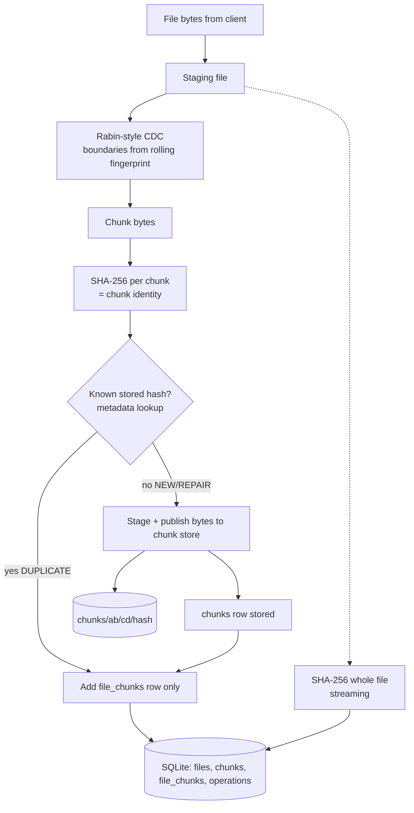
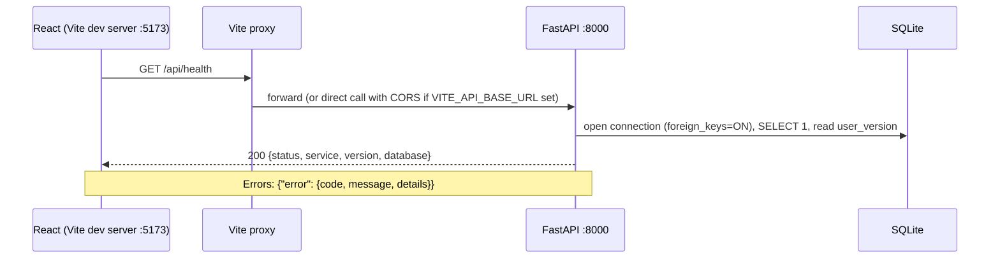

# Data Flow and API Communication

## Upload data flow (planned)

Metadata flows to SQLite; bytes flow to the filesystem. They are joined only by the SHA-256 hash.

## API communication flow (Phase 1, implemented)

Startup/shutdown: on startup the app creates `data/{chunks,staging,benchmarks}` and applies the
schema (idempotent, inserts nothing). Connections are opened per request and closed after it.
