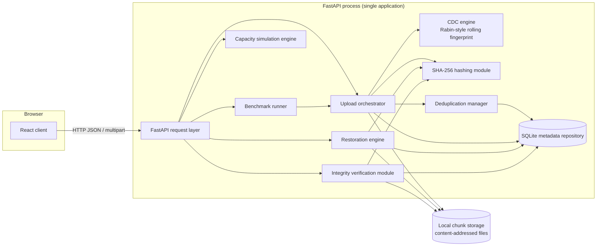

# High-Level Design

ChunkVault is **one FastAPI process** with modular internal components. There are no
microservices, queues or distributed workers; components call each other in-process and
run sequentially.

Request path: `Client → React frontend → FastAPI → CDC engine → SHA-256 → Deduplication manager → SQLite metadata + local chunk store`.

## Component diagram

Phase 2 implements every box except the benchmark runner and capacity simulation engine
(interfaces only, Phases 6-7). The React client (Phase 3) is an interactive view of the real API: dashboard, file storage with a chunk explorer and file comparison, architecture diagrams, a read-only database explorer, the integrity audit and the documentation viewer.

## Components, responsibilities and dependencies

| Component | Responsibility | Depends on |
|---|---|---|
| React client | UI shell, navigation, calls the API. Holds no storage logic. | FastAPI |
| FastAPI request layer | Routing, validation, error envelope, CORS, OpenAPI, per-request DB connection. No business logic. | orchestrator, restoration, auditor, benchmark, simulation |
| Upload orchestrator | Runs the upload pipeline and owns its transaction/failure handling. | CDC, hashing, dedup manager, repository, chunk store |
| CDC engine | Decides chunk boundaries with a rolling fingerprint. Pure; no I/O beyond reading the stream. | `CDCConfig` only |
| SHA-256 hashing module | Chunk identity and integrity digest; streaming whole-file digest. Pure. | stdlib `hashlib` |
| Deduplication manager | Classifies each chunk NEW / DUPLICATE / ADOPT from metadata *and verified bytes*. | repository |
| SQLite metadata repository | All metadata reads/writes; schema and invariants. | SQLite |
| Local chunk store | Stores chunk bytes at `chunks/ab/<sha256>`; stage + atomic publish. | filesystem |
| Restoration engine | Reassembles a file chunk by chunk, verifying every hash. Read-only. | repository, chunk store, hashing |
| Integrity auditor | Read-only detection of divergence between metadata and bytes; a separate, explicit reconciler removes crash leftovers. | repository, chunk store, hashing |
| Benchmark runner | Measures the pipeline on an isolated store. | orchestrator |
| Capacity simulation engine | Pure analytical model from user assumptions. | none |

**Key separation:** metadata (SQLite) and chunk bytes (filesystem) are stored separately; the
two cannot be committed atomically together — see [consistency-protocol.md](consistency-protocol.md).

## Rolling fingerprint vs SHA-256

| | Rolling fingerprint | SHA-256 |
|---|---|---|
| Purpose | Find chunk *boundaries* | Chunk *identity* and *integrity* |
| Computed over | Sliding 64-byte window | The whole chunk |
| Collision-resistant | No (cheap, not cryptographic) | Yes |
| Stored | Never | In `chunks.hash`, file name, `file_chunks` |

See also: [lld.md](lld.md), [sequences.md](sequences.md), [data-flow.md](data-flow.md),
[cdc-specification.md](cdc-specification.md), [../database/schema.md](../database/schema.md).
