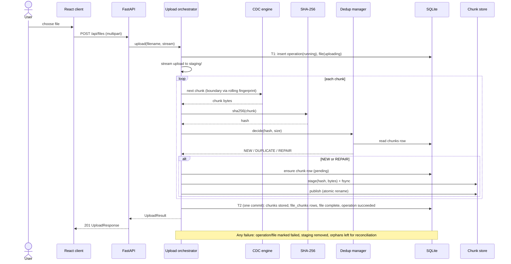

# Sequence Diagrams (the implemented upload and restore behaviour)

## Upload



## Restore

```mermaid
sequenceDiagram
    actor U as User
    participant UI as React client
    participant API as FastAPI
    participant R as Restoration engine
    participant DB as SQLite
    participant S as Chunk store
    participant H as SHA-256

    U->>UI: click restore
    UI->>API: GET /api/files/{id}/download
    API->>R: restore(file_id)
    R->>DB: file (must be complete) + file_chunks ordered by chunk_index
    alt not found / not complete
        R-->>API: FileNotRestorableError
        API-->>UI: 404 error envelope
    else
        loop each chunk in order
            R->>S: read(hash)
            S-->>R: bytes (or ChunkNotFoundError)
            R->>H: verify(bytes, hash)
            R-->>API: yield bytes
            API-->>UI: stream bytes
        end
        R->>H: compare whole-file sha256 with files.sha256
    end
    Note over R,API: A mid-stream failure aborts the stream; wrong data is never returned as success
```
