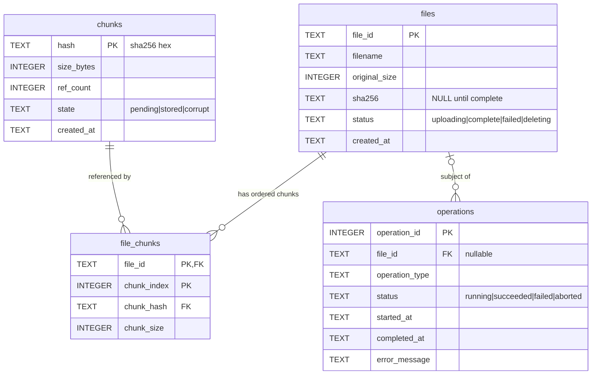

# Database Design (SQLite, schema version 1)

Source of truth: `backend/app/database/schema.sql`. Applied idempotently by
`database/init.py`; version tracked in `PRAGMA user_version`. The database starts empty.

## ER diagram

## Keys and constraints

- `file_chunks` primary key is `(file_id, chunk_index)`: positions are unique per file, while the same `chunk_hash` may appear at many positions or files.
- `file_chunks.file_id → files ON DELETE CASCADE`; `chunk_hash → chunks ON DELETE RESTRICT` (a referenced chunk cannot be deleted).
- `operations.file_id → files ON DELETE SET NULL` (history survives file deletion; NULL also for benchmark/simulation/whole-store operations).
- Hashes: 64 lowercase hex chars (`CHECK`). Sizes positive; `original_size ≥ 0` (empty file allowed, with zero chunks).
- A `complete` file must have `sha256`. A `running` operation has no `completed_at`; any other status must; `failed` requires `error_message`.
- Foreign keys are off by default in SQLite and per-connection: `connect()` sets `PRAGMA foreign_keys = ON` for every connection and verifies it.
- Indexes: `files(sha256)`, `files(status)`, `chunks(state)`, `chunks(ref_count)`, `file_chunks(chunk_hash)`, `operations(file_id)`, `operations(status, operation_type)`.

## States

| Entity | Values | Meaning |
|---|---|---|
| file | `uploading` → `complete`; `failed`; `deleting` | only `complete` files are restorable |
| chunk | `pending` → `stored`; `corrupt` | `stored` means bytes were atomically published |
| operation | `running` → `succeeded` / `failed` / `aborted` | `aborted` = found `running` after a crash |

Operation types: `upload, restore, delete, integrity_check, reconciliation, benchmark, simulation`.
Python enums mirror these in `database/states.py`; a test checks they match the CHECK constraints.

## Reference-count invariant

`chunks.ref_count = COUNT(*) FROM file_chunks WHERE chunk_hash = chunks.hash`.

Counted per **mapping row**, so a chunk repeated within one file or across files counts once per
occurrence. Triggers maintain it (`AFTER INSERT` +1, `AFTER DELETE` −1, which also fires for rows
removed by the file cascade); `CHECK (ref_count >= 0)` guards underflow. `file_chunks` rows and
`chunks.hash/size_bytes` are immutable (updates abort), and `file_chunks.chunk_size` must equal
`chunks.size_bytes`. View `v_ref_count_mismatch` lists any chunk that violates the invariant
(should be empty); the integrity auditor uses it.

A chunk row is eligible for physical deletion only when `ref_count = 0`.

## Transaction boundaries

All transactions are explicit (`connection.transaction`, `BEGIN IMMEDIATE`, rollback on any exception).

| Operation | Transactions |
|---|---|
| Upload | T1: operation + file(`uploading`). T2: new chunk rows inserted as `stored`, all `file_chunks`, file→`complete`, operation→`succeeded` (atomic). On failure: T2 rolls back; a separate transaction marks file/operation `failed`. |
| Delete | One transaction: record operation, delete the file row (cascade + triggers lower ref_counts), delete chunk rows that reached `ref_count = 0`. After commit, unlink those chunk files. The `deleting` status is not used by the engine. |
| Restore | Short transactions to start/finish the `restore` operation; other reads are autocommit. |
| Audit | Query-only connection, one deferred read transaction for a metadata snapshot; records nothing. |

The filesystem is outside these transactions — see
[consistency protocol](../architecture/consistency-protocol.md).
